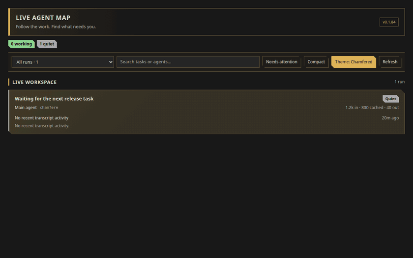
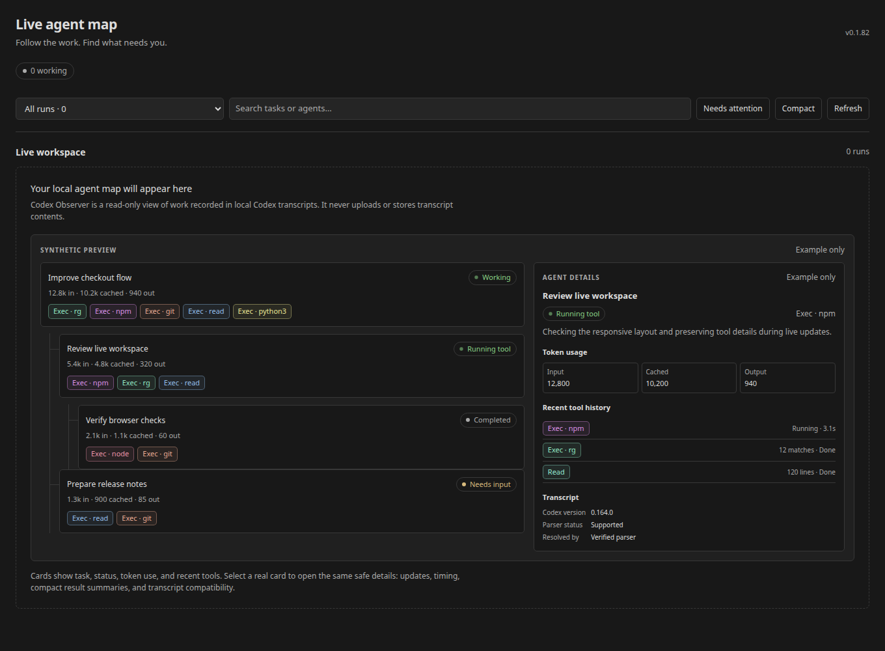
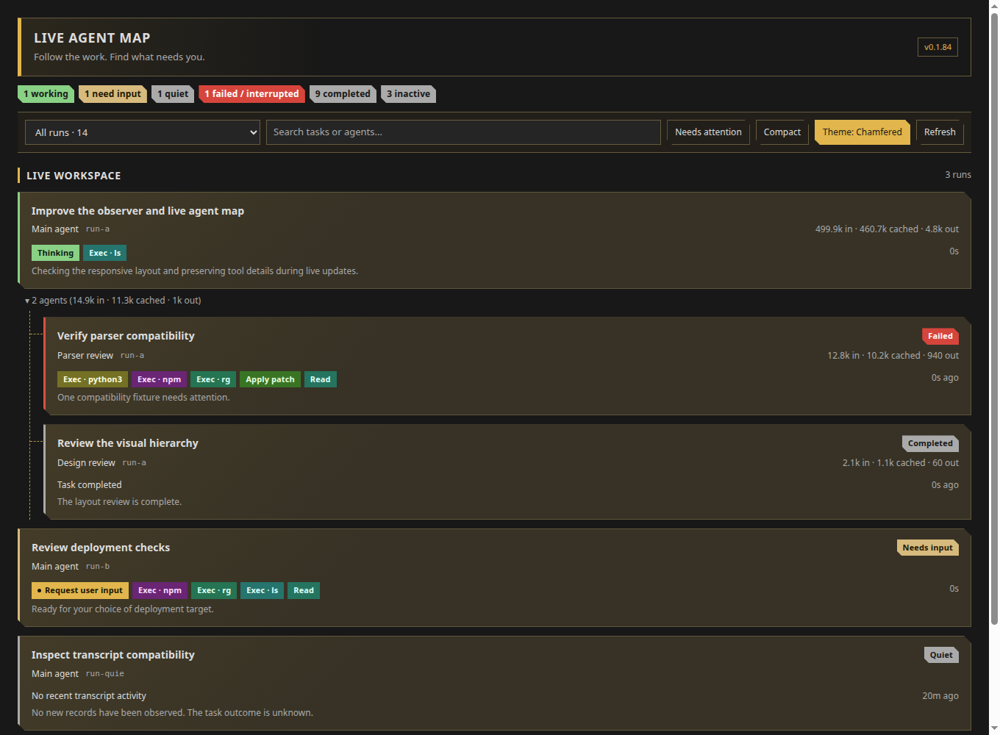

# Codex Session Observer

See your local Codex work in VS Code: active sessions, subagents, recent tools,
token use, and tasks that need attention.

## Install

1. Download the `.vsix` from [GitHub Releases](https://github.com/schelmi1/vsc-codex-session-observer/releases).
2. In VS Code, run **Extensions: Install from VSIX…** and select the download.
3. Reload VS Code if prompted.

The extension requires VS Code 1.96 or later. It currently supports Codex
`0.162.*` and `0.164.*` transcript formats.

## Use it

Open the workspace you used with Codex. The **Codex Observer** view appears in
the activity bar.

- Browse local sessions in the sidebar, then select one for its history.
- Run **Codex Observer: Open Live Agent Map** from the Command Palette or the
  sidebar title bar.
- Select a card to see updates, token totals, tool timing, and transcript
  compatibility details.
- Use **Search**, the run picker, and **Needs attention** to focus the map.
- Switch between **Default** and **Chamfered** with the button at the top. Drag
  the divider to resize Agent Details on wider windows.

The map keeps current work in **Live workspace**. Older quiet, failed, and
interrupted agents move into collapsed history, while remaining available to
inspect.

### Empty workspace preview

When no local session matches the open workspace, the extension shows clearly
labelled dummy data so you can see how the map works.

### Chamfered theme

## Privacy

Codex Session Observer reads local Codex sessions only. It does not send
transcripts anywhere, store transcript copies, start processes, or read
`auth.json`. Tool history shows safe summaries such as duration, status, and
recognised result counts; it does not expose raw command arguments, output,
paths, URLs, or environment values.

By default, sessions are limited to the open workspace. Set
`codexSessionObserver.showOtherWorkspaces` to see all local sessions. You can
also adjust when quiet work moves to history with
`codexSessionObserver.inactiveAfterMs`.

## Help and contributing

Report a problem with the [issue forms](https://github.com/schelmi1/vsc-codex-session-observer/issues/new/choose),
read [known issues](docs/KNOWN_ISSUES.md), or see [CONTRIBUTING.md](CONTRIBUTING.md)
and [SECURITY.md](SECURITY.md).

Built with [OpenAI Codex](https://openai.com/codex/).
